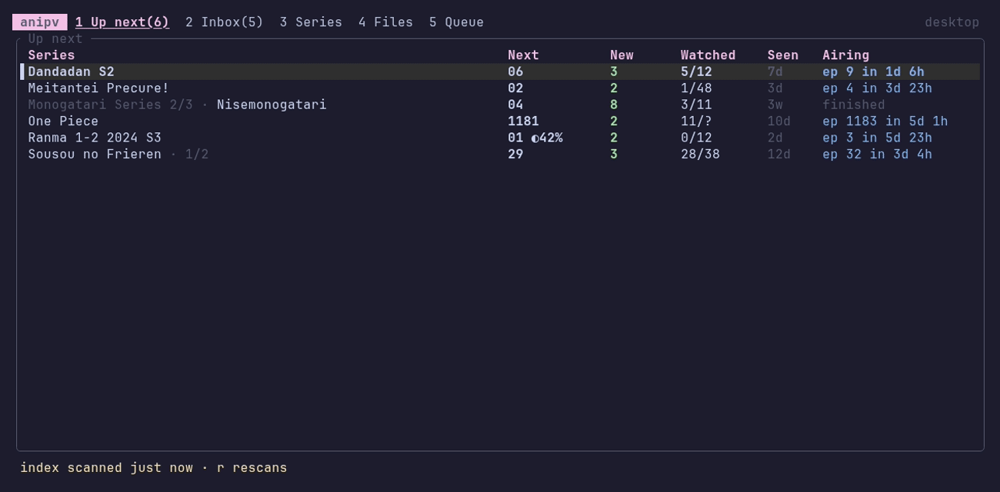
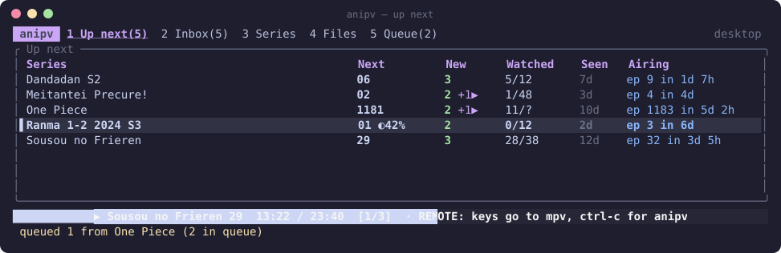
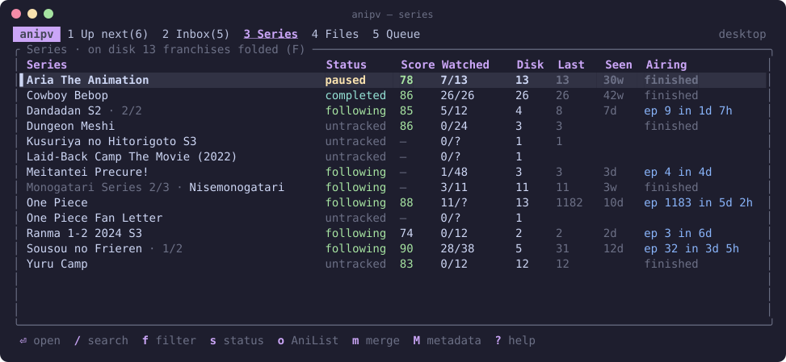
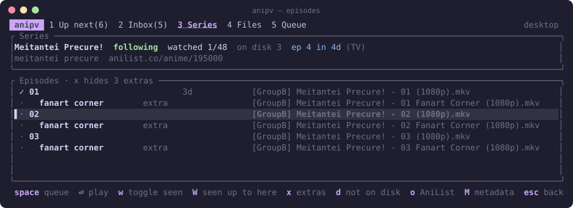
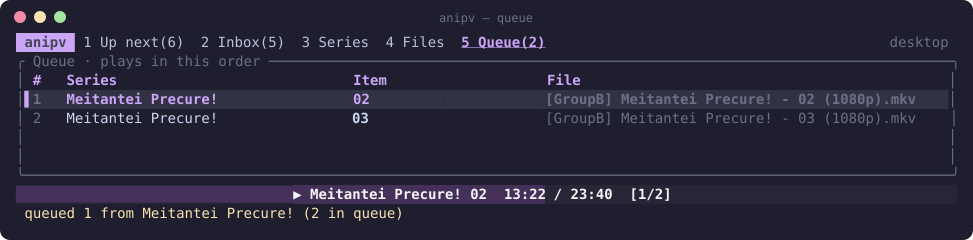
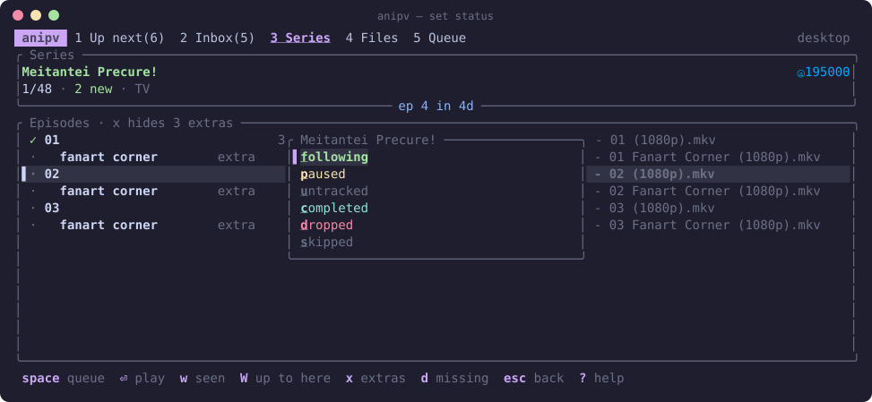
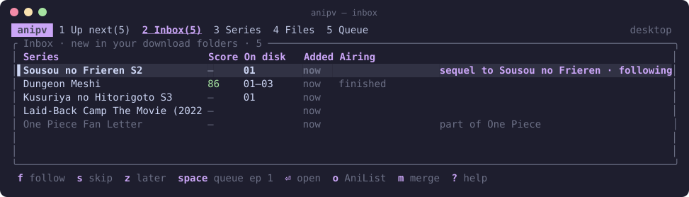
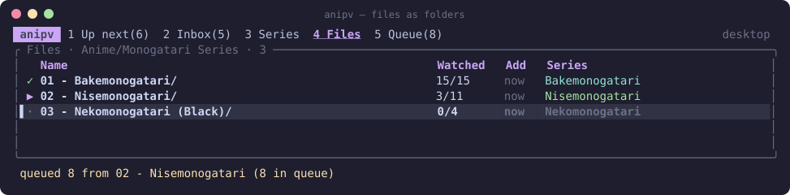
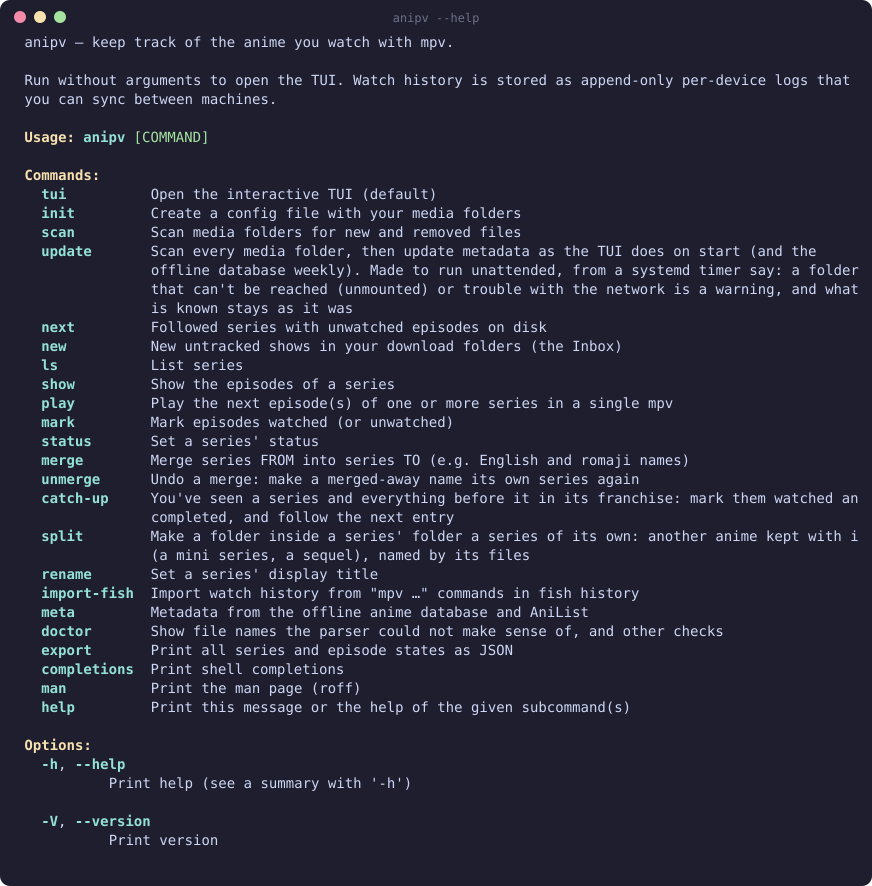

<h1 align="center">anipv</h1>

<p align="center">
  <b>Keep track of the anime you watch with mpv: what's new, what's next, what you dropped.</b><br>
  A terminal UI that indexes your anime folders, launches <code>mpv</code> for you and remembers how far you got.
</p>

<p align="center">
  <a href="https://github.com/kazie/anipv/actions/workflows/ci.yml"></a>
  
</p>

<p align="center"></p>

You keep anime in a downloads folder and an archive. You play episodes with
`mpv A.mkv B.mkv …`, and your memory of where you were lives in your shell
history. anipv replaces that:

- **Up next**: every series you follow, with the next unwatched episode on disk, how many new ones arrived, and when the next one airs.
- **Inbox**: new shows that appear in your download folder, newest first, with a new season of something you watch at the top. Follow (`f`), skip (`s`) or leave it for later (`z`).
- **Queue & play**: mark episodes from several shows, press `p`, and they play in one mpv session, just like `mpv A B C`.
- **Automatic tracking**: anipv follows mpv over its IPC socket. Finished episodes are marked watched; stop half-way and it resumes there next time (`P` starts over).
- **Remote control**: while mpv plays, keys typed in anipv go to mpv, so your `input.conf` bindings (pause, seek, quit, …) work from the terminal even when the video is fullscreen on another screen. `ctrl-c` takes the keys back, `v` hands them over again.
- **Your library, understood**: bracketed (`[Group] Show - 07 (1080p)`), dotted (`Show.S01E07.1080p…`), underscored and numbered file names, `v2` versions, `S02E01` / `1x05` markers, season folders (inside an archive series folder, `Season 1` and `Season 2` stay separate seasons of the same title), OVAs, openings/endings, previews, multi-episode files. Parsed and grouped, with a test corpus covering each naming convention.
- **Statuses**: following, paused ("dropped too early, might resume"), dropped (with a note), completed, skipped. A status you set on a series you've already finished stays, so you can follow it again for a rewatch.
- **Franchises**: seasons, sequels and the numbered entries of a franchise folder (`Monogatari Series/01 - Bakemonogatari`, `02 - …`) are grouped and ordered for watching, from folder numbers, season markers and AniList's prequel and sequel links. In a franchise folder the order is the folders', even when one anime spans several of them with another in between. Finish an entry and anipv follows the next one, if it is on disk and you haven't decided on it yet; `anipv catch-up <series>` (`C` in the TUI) marks it and everything before it watched when your history doesn't know you've seen them.
- **Local first, multi-device**: history is an append-only log per device. Sync the folder however you like; merging is conflict-free.
- **Optional metadata**: episode totals, airing dates and audience scores from the offline [anime-offline-database] (the community-maintained continuation of manami-project's archived dataset) and anonymous [AniList] queries. No account needed, and nothing about your watching leaves your machine.
- **Bootstrap from fish**: imports the `mpv …` commands already in your fish history.

## Install

There are no prebuilt binaries; build it yourself (Rust 1.99+). anipv is
Unix-only (mpv is controlled over a Unix socket, so Windows isn't supported)
and is developed and tested on Linux.

```sh
git clone https://github.com/kazie/anipv && cd anipv
just install    # release build, installed as ~/.cargo/bin/anipv
```

Make sure `~/.cargo/bin` is on your `PATH`. [`just`](https://github.com/casey/just)
runs `cargo install --path . --locked`, which always builds in release mode.
Without `just`, run that command yourself (add `--root ~` to install as
`~/bin/anipv` instead), or skip the checkout:

```sh
cargo install --git https://github.com/kazie/anipv --locked
```

Re-run it after `git pull` to update.

Needs [`mpv`](https://mpv.io) on your `PATH`. fish is only needed for
`import-fish`. Shell completions and a man page:
`anipv completions fish > ~/.config/fish/completions/anipv.fish`, `anipv man > anipv.1`.

## Quick start

```sh
# 1. Tell anipv where your anime lives.
#    ongoing = loose files, series from file names
#    archive = one folder per series
anipv init --ongoing ~/media/Downloads --archive ~/media/Anime
#    (config goes to ~/.config/anipv/config.toml, history to
#    ~/.local/share/anipv/events; add --events-dir <synced folder> to share history)

# 2. Index it (also happens in the background every time the TUI starts).
anipv scan

# 3. Optional: import what you've already watched from fish history.
anipv import-fish --dry-run        # look first
anipv import-fish --apply-status   # mark watched + follow recent shows

# 4. Optional: episode totals and airing times
#    (or press ctrl-r in the TUI, which downloads the anime database for you).
anipv meta refresh --all
#    Add --untracked once for scores of the rest of your library too
#    (sends AniList the id of every anime in it).

# 5. Go.
anipv
```

Just want to look around? `just demo` opens a fake library. The demo
library and the fake player behind the tests are left out of regular builds;
they come with the `demo` Cargo feature (`cargo run --features demo -- demo target/anipv-demo`).

## The TUI

<p align="center"></p>

**Up next**: what to watch next in every series you follow.

| | |
| --- | --- |
|  |  |
| **Series**: everything on disk, filterable by status and fuzzy-searchable by any of its titles (romaji, English, native). Filter on AniList data too: `studio:madhouse`, `year:2023`, `season:fall`, `score>80`, `#hashtag`. Merge different names of the same show (`m`). | **Episodes**: watched ✓, started ◐; extras tucked under their episode (`x`). Episodes no longer on disk stay out of the way until `d`. The seasons around it are a row away (`▲`/`▼`, or `[`/`]`), those you don't have too (from AniList), and related entries (side stories, films) are listed after the episodes. Episodes numbered on through several seasons (`25` being season 2's `01`) are split among them. |
|  |  |
| **Queue**: reorder with `J`/`K`, play with `p`, or `y` to copy the plain `mpv …` command. | **Status**: `s`, then a letter. Dropping or pausing asks for an optional note. |

<p align="center"></p>

**Inbox**: everything new in your download folder that you haven't decided on yet. A new season of something you watch is flagged and sorted first (by title, and by AniList's prequel links); specials of other shows go last. The Score column (AniList's average, 0–100; the anime database's until AniList has been asked) gives a first idea of how well liked a show is, and `o` opens its AniList page.

<p align="center"></p>

**Files**: the newest files in your download folders, or (`t`, or `4` again) every folder, file-manager style: `⏎` goes in, `h` goes up, `/` finds a folder by its path. Each folder shows how much of it you've watched; `space` queues its unwatched episodes in order, `w` marks it all watched.

Common keys: `1`–`5` switch views, `space` queues, `p` plays, `s` sets the
status, `/` searches, `M` refreshes metadata for the series under the cursor,
`ctrl-r` refreshes all of it, `o` opens the series on AniList, `q` or `ctrl-c` quits (after asking), `?` shows everything. Full list: [docs/keybindings.md](docs/keybindings.md).

## The CLI

Everything the TUI does is also scriptable:

<p align="center"></p>

```sh
anipv next                            # what's new for followed series
anipv play "one piece" frieren -n 2   # next 2 episodes of each, one mpv, tracked
anipv play frieren --print            # just print the mpv command
anipv mark "grand blue" 1-12          # mark watched
anipv status "k-on" dropped --note "not for me"
anipv merge "even the student council" "seitokai ni mo ana"
anipv catch-up owarimonogatari        # seen it and all before it: follow the next entry
anipv split "carole & tuesday" "Mini Series"   # another anime kept in a show's folder
anipv show frieren
anipv export | jq '.[] | select(.status=="following") | .title'
anipv update                          # scan + metadata, unattended (for a timer)
```

### Keep the index fresh in the background

`anipv update` scans every media folder and then updates metadata the way the
TUI does on start (stale airing info, matching, the offline database once a
week). Run it from a systemd user timer and the TUI no longer needs to scan when
it starts: it does so only when a folder was last looked at more than
`scan_fresh_for` minutes ago (30 by default), and while it is open it picks up
what the timer found within half a minute.

```sh
just install          # the timer runs ~/.cargo/bin/anipv
just install-timer    # every 15 minutes, and 2 minutes after you log in
systemctl --user list-timers anipv-update.timer
journalctl --user -u anipv-update -n 30
just uninstall-timer
```

The recipe copies [`contrib/systemd/`](contrib/systemd) to
`~/.config/systemd/user/`; a rebuilt anipv is used without installing it again.
It is lenient by design: an unmounted folder (an rclone mount that isn't up)
or no network is a warning in the journal, and what anipv knows stays as it
was until a later run can reach it. Nothing is ever dropped from the index
because a folder couldn't be read. With `refresh_untracked = true` it also
refreshes the series you don't track, a few at a time (see
[Privacy](#privacy)).

## How it works

```
media folders ──scan──▶ index (SQLite cache)      events/<device>.jsonl  ◀── your history
                                 └──────── library ◀─────── replay ┘
                                              │
                                     TUI / CLI ──▶ mpv ──IPC──▶ watched / progress events
```

- **Nothing is keyed on file paths.** History is stored per *series* and *episode*
  (`one piece`, ep `1180`), so moving files from Downloads to the archive, a
  differently named copy or another mount point on your laptop doesn't matter.
- **Archive roots**: the top-level folder names the series; a season 2 or later
  (an `S02E01` marker, or a `Season 2` / `S02` folder below it) becomes its own
  series of that title (`show s2`). Download roots take the series from file
  names. See [docs/config.md](docs/config.md#roots).
- **The event log is the only thing that matters.** The index and metadata are a
  cache you can delete. See [docs/events.md](docs/events.md) for the format.
- **Syncing between machines**: point `events_dir` at a synced folder (Syncthing,
  Nextcloud, git…). Each machine writes only its own file, so there are no conflicts.

### Privacy

anipv makes two kinds of network requests by default, both optional, and a third that is off until you turn it on:

1. `anipv meta update` downloads the public [anime-offline-database] JSON from GitHub. The original [manami-project] dataset was archived in July 2026, so by default this comes from its community continuation (the archived original is the fallback when nothing is cached yet). Set `offline_db_url` to use another source.
2. For series you *follow*, it asks [AniList]'s public API about the anime by id
   (`next airing episode`, `episode count`, `average score`, `popularity`, its titles, studios,
   season and hashtags). No account or token is involved, and
   nothing is ever sent about what you watched. Set `anilist = false` to turn it off.
3. **Off by default**: with `anilist_search = true` (or `anipv meta match --search`),
   series the offline database can't match (all of them while none is
   downloaded), such as shows newer than a stale dataset, are looked up on
   AniList by title. What is sent is the titles anipv
   shows for those series (parsed from your file and folder names), nothing
   else: no paths, no watch history. Each series is asked about at most once a
   month, at most 10 per update.

`anipv meta refresh --all --untracked` asks the same about every anime in your
library, tracked or not: AniList then sees which anime you have, though still
nothing about what you watched. It only runs when you ask for it, or a few at a
time from `anipv update` when you set `refresh_untracked = true`.

For series you engage with, anipv also walks their franchise on AniList: the
ids AniList returned as their prequels, sequels and spin-offs are asked about
in turn (once a month each), so the seasons you haven't got show up. Only
those ids are sent, no titles.

anipv keeps to AniList's [rate limits](https://docs.anilist.co/guide/rate-limiting):
it paces its requests by what AniList says is left, and when it is told to
wait anyway, it waits and tries again (the TUI header shows the countdown).
So an update may take a little longer while AniList's API is degraded, rather
than fail.

Pressing `o` opens an AniList page in your browser; that request is yours,
made only when you ask.

More: [configuration](docs/config.md) · [architecture](docs/architecture.md) · [AniList and rate limits](docs/anilist.md) · [event log](docs/events.md) · [keys](docs/keybindings.md)

## Development

The [`justfile`](justfile) collects the usual commands; `just --list` shows them all.
[just](https://github.com/casey/just) is optional: every recipe is a plain cargo
command you can copy from the `justfile`.

```sh
just check            # fmt, clippy, tests, docs and cargo-deny (needs cargo-deny)
just ci               # check, then the MSRV build (Rust 1.99): the local version of CI
just demo             # try the TUI against a throwaway demo library
just screenshots      # regenerate the SVGs in this README
just record           # re-record the demo GIF and assets/tapes/all.txt (needs vhs and ttyd)
just update-fixtures  # update golden files after an intentional change, then review
just clean            # remove build artifacts
just gc               # garbage-collect stale build artifacts (>14 days old, or e.g. `just gc 3`)
just install          # install a release build to ~/.cargo/bin
```

- Tests are unit, property, snapshot and end-to-end tests (`cargo test`). After an
  intentional UI change, review snapshots with `cargo insta review`.
- The parser is tested against `tests/fixtures/filenames.tsv`, one example per naming convention.
  After an intentional parser change: `UPDATE_FIXTURES=1 cargo test --test parser_corpus`
  and review the diff.
- `anipv doctor` lists files in your own library that parse without an episode
  number. Good candidates for new fixtures.
- The SVG screenshots are drawn with a fixed clock, so `just screenshots`
  changes them only when the screens change. The GIF is recorded in real time
  and never comes out byte-identical; `just record` also writes
  `assets/tapes/all.txt`, the screen as text after each step of the tape. If
  `git diff assets/tapes/all.txt` shows nothing, the demo didn't change (only
  timing or colors can differ) and `git restore assets/img/demo.gif` drops the
  new GIF.
- CI runs fmt, clippy, tests on stable and MSRV, docs and `cargo-deny`.
  Dependabot keeps crates and actions current.

[anime-offline-database]: https://github.com/cedya77/anime-offline-database
[manami-project]: https://github.com/manami-project/anime-offline-database
[AniList]: https://anilist.co
